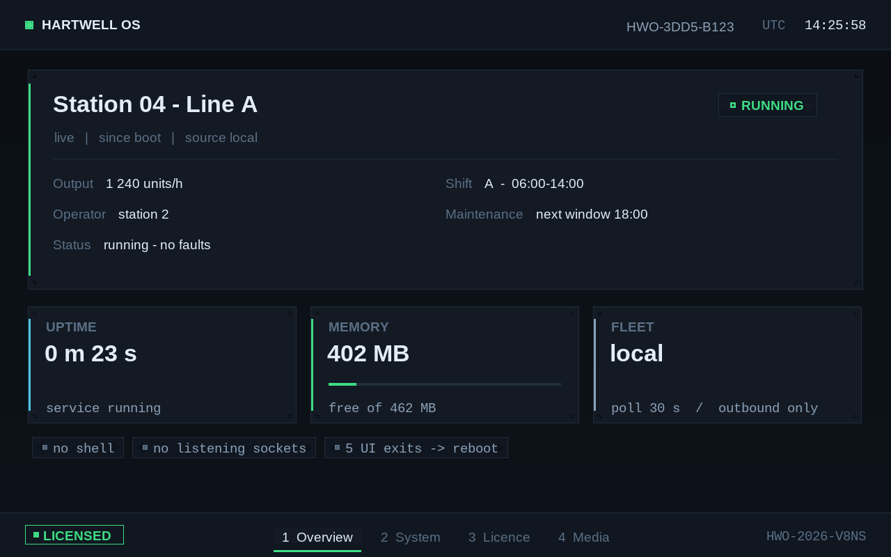
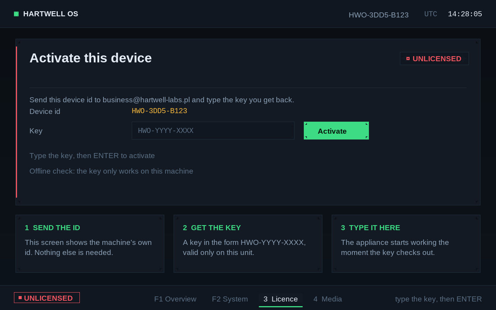
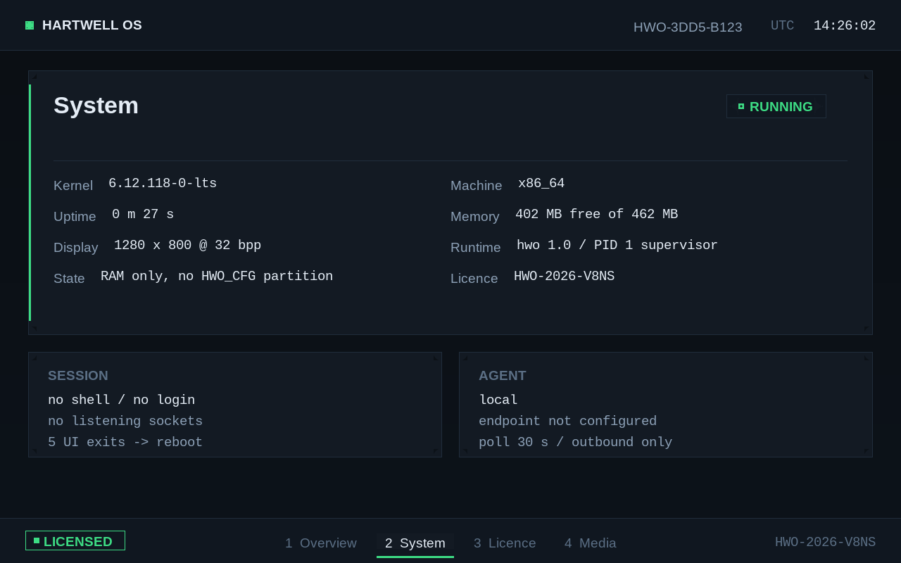

# Hartwell OS 1.0

A single-purpose appliance operating system. It boots straight into a 1280×800 interface
that shows one machine's state, and there is no shell, no package manager, no remote login
and no open port behind that screen.

Measured on this machine: **1.06 s** from kernel start to PID 1 under QEMU/KVM, 12 s under
software emulation (TCG). No bare-metal measurement yet.



## What is actually in the box

| Part | Detail |
|---|---|
| Kernel | Linux 6.12.118 LTS (Alpine `vmlinuz-lts`), x86_64 |
| Userspace | Alpine 3.22 minirootfs, busybox only |
| Runtime | `hwo` — one static binary, 1.2 MB, no libc on target |
| Image | bootable ISO, 25 MB, El Torito (BIOS + UEFI) + initramfs |
| Display | 1280×800 framebuffer, 32 bpp, drawn by `hwo` itself — no X, no Wayland |
| UI | left navigation rail with 4 screens: Overview, System, Licence, Media; **keyboard + mouse** (1–4 / F1–F4, clickable) |
| Init | `/init` as PID 1, mounts proc/sys/devtmpfs, supervises the UI |
| Crash policy | 5 UI exits → automatic reboot |
| Errors | every failure has a stable code (`F`/`E`/`W` + 4 digits), echoed to serial and `/run/hwo.err`, counted in a **System** screen chip (amber `WARN`, red `ERR`); the full book is `docs/errors.md` |
| Rescue | kernel flag `hwo.rescue=1` or the **Rescue** entry in the boot menu → no UI, no agent, `/bin/sh` on the console with `hwo errs` (log + the fix for each code) |
| Licence | offline, bound to the device: **Ed25519-signed** licence file verified with an embedded public key (unforgeable, non-transferable); `HWO-YYYY-XXXX` stays as a demo serial |
| State | `HWO_CFG` VFAT partition: licence + content survive reboot |
| Fleet agent | optional, outbound only; **DHCP + route + resolv.conf** are brought up at boot, endpoint from `/etc/hartwell/agent.conf` or `hwo.url=`, polls every 30 s |
| Input | **PS/2 or USB keyboard+mouse via evdev** (works with no VT session) |
| RAM | 128 MB is plenty; tested in 256 and 512 MB |
| Media | **PNG sequence decoder** — own `inflate` in `src/png.c`, plays `frameNNNN.png` from `/state/media`; FPS 1–60, default 10; `poster.png` still image; `ffmpeg` → `tools/mkmedia.sh` converts video clips to PNG sequence |
| Secure Boot | **own PK/KEK/db** (openssl), `sbsign` loader signatures, `db.cer` + `*.auth` for client; test in OVMF secboot with vars built by `virt-fw-vars` (image `hartwell-sbtools:1`, Debian bookworm) |

`dist/` ships unlicensed: run `./build.sh` with `HWO_KEY`/`HWO_DEVICE` to bake in a licence.

`hwo` modes: `id`, `license`, `ui`, `fbprobe` (draws a test pattern, exits), `vcsa FILE` (text-console dump, still used by the proof image), `errs` (print the log with fixes), `err CODE msg` (write one event, used by the init scripts).

## Build

```sh
./build.sh                          # unlicensed image
HWO_KEY=HWO-2026-V8NS HWO_DEVICE=HWO-3DD5-B123 ./build.sh
```

Output in `dist/`:

- `hartwell-os-1.0.iso` — what customers boot
- `hartwell-os-1.0-proof.iso` — same rootfs, serial console, dumps its own screen to COM1
- `initrd`, `vmlinuz`, `SHA256SUMS`

Requires `gcc` and `docker` (the ISO step installs syslinux/xorriso in a throwaway container).
The kernel and rootfs tarball are cached in `buildroot/`.

## Run

```sh
qemu-system-x86_64 -cdrom dist/hartwell-os-1.0.iso -m 256 -uuid <device-uuid>
```

Without a licence the machine boots into the activation screen and stays there:





## Licensing

The device id comes from the DMI product UUID (falling back to `/etc/machine-id`):

```
HWO-<fnv1a(uuid) high 16 bits>-<low 16 bits>
```

The key suffix is 4 base32 characters of `fnv1a("<device id>|hartwell-os-v1-7f3a91c2")`.
Validation is pure arithmetic on the device — nothing is called home, no activation server
can go down.

```sh
./tools/keygen.py --uuid 9d2f7c1e-8b4a-4c61-9f2d-3a5b6c7d8e9f
# device=HWO-3DD5-B123
# key=HWO-2026-V8NS

./tools/keygen.py --device HWO-3DD5-B123
```

Type the key on the unit (keyboard, `ENTER`), or bake it in with `HWO_KEY`/`HWO_DEVICE`:

```
key=HWO-2026-V8NS
device=HWO-3DD5-B123
```

If the `device=` line does not match the machine, the key is rejected, so a copied key file
does not move between units. A key typed on the device is written to the `HWO_CFG` state partition when the
machine has one, so it survives reboot; the initramfs copy is only a cache. The Licence screen says which
of the two is in effect (\"Stored on\").

## State partition and installing to disk

The ISO is a live image and has nowhere to write, so `./build.sh` output is RAM-only. A real
unit boots from a disk with two partitions, which `tools/mkdisk.sh` builds:

```sh
./build.sh
./tools/mkdisk.sh                                   # 126 MB image, unlicensed
HWO_KEY=HWO-2026-V8NS HWO_DEVICE=HWO-3DD5-B123 ./tools/mkdisk.sh
sudo dd if=dist/hartwell-os-1.0-usb.img of=/dev/sdX bs=4M && sync
```

- partition 1 — `HWBOOT`, FAT16, syslinux + kernel + initramfs (BIOS) and
  `EFI/BOOT/BOOTX64.EFI` as `syslinux.efi` (UEFI)
- partition 2 — `HWO_CFG`, FAT16, `/state`: `license` and `content.txt`

At boot `init` looks for any disk or partition labelled `HWO_CFG`, mounts it at `/state`,
copies the licence and content into the runtime, and the UI reports `HWO_CFG mounted at
/state` on the System screen. Every later write goes back to the partition, so a licence typed
on the unit and content pushed by the agent both survive power loss. Because it is VFAT, a
technician can put `content.txt` on the stick from Windows or macOS.

The state partition is optional: without it the unit still boots and runs, entirely from RAM.

## Media / PNG playback

Press `4` (or click the Media tab) to show the Media screen. The system decodes PNG
frames `frameNNNN.png` stored in `/state/media` (or `/etc/hartwell/media`). Frames are
embedded in the ISO when you build with `MEDIA_DIR=... ./build.sh`, and shipped under
`/state/media` on the disk image by `tools/mkdisk.sh`.
The decoder is **pure `inflate`** — no zlib/libpng dependency on the target device.
Supported PNG types: 0 (grayscale), 2 (RGB), 3 (palette), 4 (grayscale+alpha), 6 (RGBA);
all filter types 0–4; `tRNS` chunk. FPS 1–60 (default 10); `poster.png` still image if
no frames remain in the sequence. Damaged frames are skipped.

Conversion from video to PNG sequence is done by `tools/mkmedia.sh`:

```sh
./tools/mkmedia.sh --clip /tmp/clip.mp4 --fps 10 --out /state/media
```

The script uses `ffmpeg` to produce `frame0000.png`, `frame0001.png`, … starting at the
number given by `--start_number` (default 0). The UI shows `frame n of N · fps M`.

See `tools/mkmedia.sh` for full options.

## Secure Boot

The appliance can boot under OVMF with Secure Boot enabled. The build generates a full
PK/KEK/db key set and signs the UEFI loader:

```sh
./tools/secureboot.sh init   # generate PK/KEK/db in keys/
./tools/secureboot.sh sign   # sign the EFI loader
./tools/secureboot.sh verify # verify the signed image
./tools/secureboot.sh vars   # build OVMF vars file
```

Key files in `keys/` (all chmod 600):

| File | Purpose |
|---|---|
| `PK.key` / `PK.crt` / `PK.esl` | Primary Key — signs itself and KEK |
| `KEK.key` / `KEK.crt` / `KEK.esl` | Key Enrollment Key — signs db |
| `db.key` / `db.crt` / `db.esl` | Database — authorises signed OS loaders |
| `db.cer` | Client certificate — copy to `EFI/hartwell-db.cer` on the disk |
| `db.auth` | Authorisation file — copy to `EFI/hartwell-db.auth` on the disk |

To test Secure Boot:

```sh
./tools/secureboot.sh init
./tools/secureboot.sh sign build/unsigned/syslinux.efi build/signed/BOOTX64.EFI
./tools/secureboot.sh vars build/OVMF_VARS.sb.fd
qemu-system-x86_64 -drive file=dist/hartwell-os-1.0-usb.img -m 512 \
  -bios build/OVMF_CODE_4M.secboot.fd -drive file=build/OVMF_VARS.sb.fd,format=raw \
  -serial file:/dev/null -no-reboot -uuid 9d2f7c1e-8b4a-4c61-9f2d-3a5b6c7d8e9f
```

The loader in `dist/` is signed with the same key set (built into `build/signed/BOOTX64.EFI`).
See `tools/secureboot.sh` for the full init/sign/verify/vars workflow.

## Content

The Overview screen is driven by `/etc/hartwell/content.txt`, one `Label | value` pair per
line, plain ASCII:

```
Station 04 - Line A | live | since boot | source local
Output | 1 240 units/h
Shift | A - 06:00-14:00
Operator | station 2
Maintenance | next window 18:00
Status | running - no faults
```

The first line is the card title plus small tags; the rest become the label/value rows.

With `HWO_URL` set (kernel parameter or environment for the agent), the agent fetches
`$HWO_URL/content.txt` every 30 s, replaces the local copy atomically, and POSTs
`device=...&state=...` to `$HWO_URL/heartbeat`. It never listens, never opens a port.
Status lands in `/run/fleet.status` (`online`, `offline`, `local`).

## Verification

The screenshots above are not mockups: they are `screendump` output from the QEMU monitor,
taken from the guest's real framebuffer while the UI was running.

```sh
docker run --rm -v \"$PWD/dist:/d\" alpine:latest sh -c \\
  'apk add --no-cache qemu-system-x86_64; qemu-system-x86_64 -cdrom /d/hartwell-os-1.0.iso \\
   -m 512 -vga std -display none -monitor stdio -uuid 9d2f7c1e-8b4a-4c61-9f2d-3a5b6c7d8e9f'\n# then on the monitor: screendump /d/x.ppm   /   sendkey 2   /   quit
```

The older text-console path (`hwo vcsa` + `render_console.py`) still exists and is what the
proof image uses:

```sh
./build.sh
docker run --rm -v \"$PWD/dist:/d\" alpine:latest sh -c \\
  'apk add --no-cache qemu-system-x86_64; qemu-system-x86_64 -cdrom /d/hartwell-os-1.0-proof.iso \\
   -m 256 -display none -serial stdio -uuid 9d2f7c1e-8b4a-4c61-9f2d-3a5b6c7d8e9f'\n# ... --CONSOLE-- <hex dump> --END--\npython3 render_console.py dump.txt out.png
```

## Known limits, stated plainly

- **No browser or video layer.** The screen is a rendered interface (cards, text, licence
  state), not HTML/WebGL and not video playback. A customer who needs a web page or a video
  wall needs a different layer than this one.
- **Mouse supported** — USB tablet/evdev via `usbhid`/`uhci_hcd`. Cursor drawn in shadow
  buffer, hit-testing for tabs and Activate button. PS/2 impossible (no `i8042` module in
  `buildroot`), so USB only.
- **Secure Boot optional.** Both BIOS and UEFI boot paths work, but the EFI binary is
  signed at build time. Secure Boot can be turned on with `tools/secureboot.sh`; the key
  set is in `keys/`. Without enrolment the unit boots with Secure Boot off (default).
- **Graphics is validated in QEMU only** (bochs-drm / virtio-gpu / simplefb). Real hardware
  needs the matching DRM driver staged in `modules.load`; the module list is generated by
  `tools/stage_modules.py`, so adding a GPU is a configuration change, not new code.
- **Fleet agent is HTTP-only and was not exercised against a live fleet server here**; the
  DHCP lease, default route, `/etc/resolv.conf` and endpoint wiring are in place, and the
  UI reports the agent state (`local` / `online` / `offline`).
- **Audio is not implemented**; the Media screen is video-only (PNG frames, no sound).
- **No real video codec**: playback is a PNG frame sequence, not H.264/VP9. Converting
  clips is `tools/mkmedia.sh` (ffmpeg → frames).

## Files

```
src/hwo.c        appliance runtime (id / license / ui / fbprobe / vcsa)
src/hwo.h        runtime <-> UI interface
src/errors.c/.h  error codes, /run/hwo.err, serial echo, `hwo errs`
docs/errors.md   the error book: every code, symptom → fix → verify
src/fbui.c       the whole graphical interface: rail, pages, input, present()
src/rescue.sh    rescue console banner, helpers and shell dressing
tools/hwo-view.py  live view of a machine in a browser, with forwarded input
src/font.h       generated bitmap atlases (393 KB)
src/init.sh      PID 1: mount, load DRM modules, supervise the UI
src/agent.sh     fleet agent (DHCP-aware, outbound HTTP)
src/content.txt  default overview content
src/monocypher.c/.h  vendored EdDSA (licence signatures)
build.sh         rootfs + initramfs + ISO
tools/hwo-lic.c  vendor EdDSA licence tool (gen / sign / verify)
tools/keygen.py  licence generator (signs the device id)
tools/mkdisk.sh  bootable USB/disk image with the HWO_CFG state partition
tools/mkmedia.sh  clip → PNG sequence (ffmpeg + own inflate decoder)
tools/mkfont.py  TTF → src/font.h
tools/stage_modules.py  kernel module dependency resolver
render_console.py  vcsa dump → PNG
index.html       product page
```

## Licence and what is open

Source is MIT (`LICENSE`). The trust root (`keys/`) and the signed, licence-baked
images are not in the repository — see `LICENSING.md` for the exact boundary and
for what a licence actually buys.

`web/` holds the browser port of the interface: the same drawing primitives,
layout arithmetic and glyph bitmaps as `src/fbui.c`, rendered to a canvas. It is
what runs at <https://hartwell-labs.pl/os/>. The layout stays in 1280×800
coordinates and every primitive multiplies by `S`, so the frame is rasterised at
2× (2560×1600) and stays sharp on a HiDPI panel while the 1× build still matches
the framebuffer pixel for pixel.

Regenerate the atlases after touching `tools/mkfont.py`:

```sh
python3 tools/mkfont.py            # src/font.h    — 1x, used by the ISO
python3 tools/mkfont.py --scale 2  # src/font2x.h  — 2x, used by the browser
node web/build-font.mjs > web/font.json && gzip -9 -c web/font.json > web/font.json.gz
```
